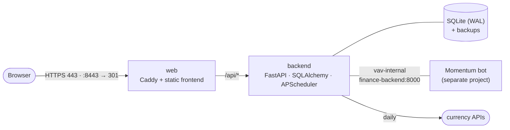

# Finance Tracker

[](https://github.com/z1ec/VAV-finance-tracker/actions/workflows/ci.yml)
[](https://github.com/z1ec/VAV-finance-tracker/actions/workflows/deploy.yml)

A self-hosted, multi-currency expense tracker for a small household — **HUF, EUR and RUB** with
HUF as the base currency, a dashboard, monthly budgets per category and role-based access.
The interface is in Russian; code and docs are in English.

Live at `https://finance.fomin-vladimir.ru` (private, login required).

## Highlights
- **Money done right.** Every expense stores the original amount, the exchange rate *frozen at
  write time*, its source and the HUF amount — reports never change when rates do. `Decimal`
  arithmetic, per-currency rounding (HUF 0, EUR/RUB 2 decimals).
- **Rates without API keys.** Daily rates from `@fawazahmed0/currency-api` with an `open.er-api`
  fallback; a deterministic lookup order (exact date → previous date → fetch → ask for a manual
  rate); manual rates always win.
- **Dashboard and budgets.** Totals with period-over-period change, breakdowns by category and
  currency, top expenses, monthly limits per category and overall; Chart.js, dark theme,
  display currency switch.
- **Roles enforced in the API.** `admin` edits, `user` reads; tests assert 403 on every admin endpoint.
- **Safe operations.** Refuses to start on a real domain with default or weak secrets; SQLite
  backups nightly and before every pending migration; health-checked deploys with automatic
  rollback.
- **Production-grade delivery.** Two images in GHCR (non-root FastAPI backend with HEALTHCHECK,
  Caddy web edge), CI with lint/type/test/image smoke tests, SSH deploy to a VPS shared with a
  Telegram bot over a private Docker network.

## Architecture



More: [docs/ARCHITECTURE.md](docs/ARCHITECTURE.md) · decisions in [docs/adr/](docs/adr/).

## Tech stack

| Layer | Choice |
|---|---|
| Backend | Python 3.12, FastAPI, SQLAlchemy 2, Pydantic v2, Alembic, APScheduler |
| Database | SQLite in WAL mode |
| Frontend | Vanilla HTML/CSS/ES modules, Chart.js (vendored) |
| Edge | Caddy 2 (automatic HTTPS) |
| Quality | ruff, mypy, pytest + coverage, actionlint, shellcheck |
| Delivery | Docker, GHCR, GitHub Actions, SSH deploy with health check and rollback |

## Quick start (local)

```bash
cp .env.example .env            # keep DOMAIN=localhost; set SECRET_KEY and passwords
docker compose up -d --build
open http://localhost:8080
```

Users from `.env` (`ADMIN_*`, `USER1_*`, `USER2_*`) and a starter set of categories are created on
first start. On Linux give the data directory to the container user once:
`sudo chown -R 10001:10001 data`.

### Development

```bash
cd backend
uv venv --python 3.12 .venv
uv pip install --python .venv/bin/python -r requirements-dev.txt
.venv/bin/pytest                      # tests + coverage
.venv/bin/ruff check . && .venv/bin/ruff format --check . && .venv/bin/mypy
DB_PATH=../data/dev.db BACKUP_DIR=../data/backups .venv/bin/uvicorn app.main:app --reload
# API only, http://127.0.0.1:8000
```

## Deployment

Push to `main` → CI → both images are built and pushed to GHCR with one `sha-<7>` tag → the deploy
job copies `deploy/` to the server over SSH and runs `deploy.sh`, which waits for the backend's
Docker health and the public `https://…/api/health`, and rolls both services back otherwise.
Roll back manually with *Actions → Deploy → Run workflow → image_tag*.
Details, secrets, restore and server-move playbook: [docs/DEPLOYMENT.md](docs/DEPLOYMENT.md).

## Project layout

```
backend/            FastAPI app (app/), Alembic migrations, tests, Dockerfile, pyproject.toml
frontend/           static pages and ES modules (login, expenses, dashboard, settings)
web/                Caddy image: Dockerfile + production Caddyfile
deploy/             docker-compose.prod.yml, deploy.sh
.github/workflows/  ci.yml, deploy.yml
docs/               architecture, deployment, ADRs, dev log, plan, briefs
```

## Documentation
- [CLAUDE.md](CLAUDE.md) — working agreement for AI agents: commands, module map, pitfalls
- [docs/ARCHITECTURE.md](docs/ARCHITECTURE.md) · [docs/DEPLOYMENT.md](docs/DEPLOYMENT.md) · [docs/adr/](docs/adr/)
- [docs/DEVLOG.md](docs/DEVLOG.md) · [docs/PLAN.md](docs/PLAN.md) · [CHANGELOG.md](CHANGELOG.md)
- [docs/MANUAL_STEPS.ru.md](docs/MANUAL_STEPS.ru.md) — owner's checklist (Russian)
