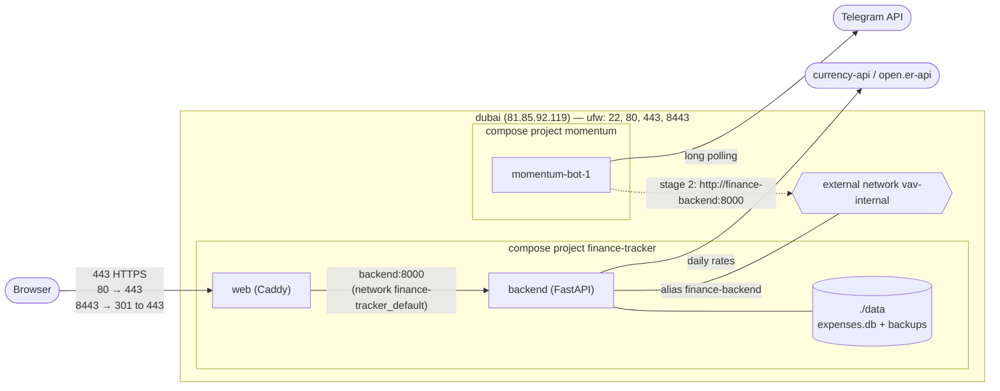
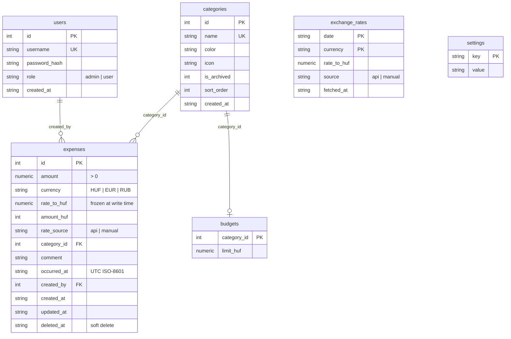

# Architecture

## Components

| Component | Image / path | Role |
|---|---|---|
| `web` | `ghcr.io/z1ec/finance-tracker-web` (caddy:2-alpine) | TLS (Let's Encrypt), HTTP→HTTPS, `:8443` → 443 redirect, static frontend from `/srv`, `/api/*` → `backend:8000`. |
| `backend` | `ghcr.io/z1ec/finance-tracker-backend` (python:3.12-slim, uid 10001) | FastAPI REST API, Alembic migrations on start, APScheduler jobs (rates, backups), SQLite in `/data`. |
| SQLite | `/opt/finance-tracker/data/expenses.db` (WAL) | Single source of truth. |
| Frontend | `frontend/` baked into the web image | Static pages + ES modules, Chart.js vendored; Russian UI. |

Startup order inside the backend (`app/main.py` → `lifespan`):
1. log `version` / `git_sha`;
2. `check_secrets` — exit on default/weak secrets if `DOMAIN != localhost`;
3. pending migrations → `pre-migrate-<UTC>.db` backup → `alembic upgrade head`;
4. seed missing users/categories; fetch today's rates if missing;
5. start the scheduler.

## Network on the shared server

- Only `web` publishes ports. The backend's port 8000 is reachable only from `web` (default
  network) and from containers on `vav-internal` (the bot, from stage 2).
- The bot has no inbound ports; its stack (`/opt/momentum`) is independent of this one.

## Data model

`settings` currently holds `total_monthly_budget_huf`. Timestamps are UTC ISO-8601 strings; the UI
renders them in `Europe/Budapest`.

## Exchange rates
- Base currency HUF. Daily job at 04:00 UTC fetches EUR and RUB from
  `@fawazahmed0/currency-api` (jsdelivr), falling back to `open.er-api.com`; on start the backend
  fetches today's rates if they are missing.
- Rate for a new expense: exact date → nearest previous date → fetch for that date → `422` asking for
  a manual rate. Manual rates win and are never overwritten by the job.
- The rate is frozen into each expense (`rate_to_huf`, `rate_source`, `amount_huf`), so history
  never changes when rates do. Rounding: HUF 0 decimals, EUR/RUB 2 (Decimal, half-up).

## Backups

| What | When | Where (host) | Retention |
|---|---|---|---|
| Nightly copy (`expenses-YYYY-MM-DD.db`) | 03:00 UTC, scheduler | `/opt/finance-tracker/data/backups/` | 14 newest |
| Before migrations (`pre-migrate-<UTC>.db`) | on start, only if migrations are pending | `/opt/finance-tracker/data/backups/` | 10 newest |
| Migration snapshots (`pre-migration-2026-11-12.db`, …) | manual, stage 1 | `/opt/finance-tracker/backups/` | kept |
| Old server snapshot | 2026-11-12, before the move | `ru-tracker:/usr/local/etc/finance/VAV-finance-tracker/backups/` | until the owner removes it |

All copies use the SQLite online backup API, safe while the app is running (WAL included).
Restore procedure: `docs/DEPLOYMENT.md`.

## Security notes
- Secrets only in the server's `.env` (600, owner `deploy`); the backend refuses to start on a real
  domain with default/short secrets.
- Session cookie: HttpOnly, SameSite=Lax, Secure on a real domain; login rate limit per IP.
- Containers: backend non-root, no published backend port, log rotation (10 MB × 3).
