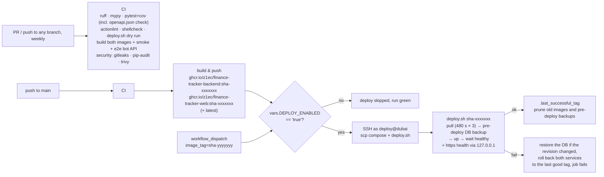

# Deployment

Production: `https://finance.fomin-vladimir.ru` on `dubai` (`81.85.92.119`, x86_64, Ubuntu,
Docker + Compose v2), directory `/opt/finance-tracker`, compose project `finance-tracker`,
shared with the Momentum bot (`/opt/momentum`). Decisions: ADR-0002, ADR-0003.

## Pipeline



## Configuration

**Repository variables** (Settings → Secrets and variables → Actions → Variables)

| Name | Value | Purpose |
|---|---|---|
| `DEPLOY_PLATFORM` | `linux/amd64` | `uname -m` on dubai is `x86_64`. |
| `DEPLOY_ENABLED` | `true` | Deploy job runs only when set. |

**Environment `production` variables** (not secrets — kept as variables so GitHub does not mask
the words `deploy` and `22` all over the logs; moved from secrets in stage 2a)

| Name | Value |
|---|---|
| `DEPLOY_USER` | `deploy` |
| `DEPLOY_PORT` | `22` |

**Environment `production` secrets**

| Name | Value |
|---|---|
| `DEPLOY_HOST` | `81.85.92.119` |
| `DEPLOY_SSH_KEY` | private half of the ed25519 key dedicated to this repo (public half in `/home/deploy/.ssh/authorized_keys`, comment `finance-tracker-deploy`) |
| `DEPLOY_KNOWN_HOSTS` | `ssh-keyscan -t ed25519 81.85.92.119`, verified against the fingerprint already in the owner's `~/.ssh/known_hosts` |

Set them without echoing secrets, e.g. `gh secret set DEPLOY_SSH_KEY --env production < key`.
The GHCR token is the workflow's temporary `GITHUB_TOKEN`, passed to `deploy.sh` via stdin.

**Server files** (`/opt/finance-tracker`, owner `deploy`)

| Path | Notes |
|---|---|
| `.env` | secrets, mode 600; keys as in `.env.example` (`DOMAIN=finance.fomin-vladimir.ru`; bot API: `BOT_API_TOKEN_SHA256`, `BOT_API_USERNAME`, `BOT_API_ALLOWED_NETWORKS=172.20.0.0/16`) |
| `data/` | owner uid 10001: `expenses.db`, `backups/` (nightly + pre-migrate) |
| `backups/` | manual snapshots (migration, password rotation) |
| `docker-compose.prod.yml`, `deploy.sh` | copied by every deploy |
| `.last_successful_tag`, `.previous_successful_tag` | written by `deploy.sh` |

## Bot API (stage 2a)
- The bot reaches the backend as `http://finance-backend:8000` on `vav-internal`
  (`172.20.0.0/16`); contract: [`API_BOT.md`](API_BOT.md), decision: ADR-0004.
- The tracker's `.env` holds only the token's SHA-256; the token is in `/opt/momentum/.env`
  (`FINANCE_API_URL`, `FINANCE_API_TOKEN`). Issue / rotate: `docs/MANUAL_STEPS.ru.md`.
- Changing `BOT_API_*` needs a backend restart:
  `cd /opt/finance-tracker && IMAGE_TAG=$(cat .last_successful_tag) docker compose -p finance-tracker -f docker-compose.prod.yml up -d --force-recreate backend`.
- `scripts/e2e_bot_api.sh <backend-image> <web-image>` runs the whole boundary check against
  throwaway containers (CI does it for every push).

## Rehearse migrations on a copy of production (before merging a schema change)
Build the new backend image **on the server** (`git archive HEAD backend | ssh dubai "tar -x -C
/tmp/src"`, `docker build`), copy the live DB with the backup API
(`docker exec finance-tracker-backend-1 sqlite3 /data/expenses.db ".backup /tmp/x.db"` +
`docker cp`), then in a `--network none` container of the new image: row counts → `alembic
upgrade head` → `PRAGMA integrity_check` + row counts again. Delete the copy, the source and the
image afterwards. Production data never leaves the server. Log of the stage 2a run: DEVLOG.

## Roll back a release
1. GitHub → Actions → **Deploy** → *Run workflow* → `image_tag` = previous tag
   (`cat /opt/finance-tracker/.previous_successful_tag` on the server, or the package list in GHCR).
2. The run skips CI/build, deploys that tag with the same health check.

`deploy.sh` already rolls back automatically when a new tag fails its health check, including
the database (since 1.3.0):

- **Image pull**: each attempt runs under `timeout ${PULL_TIMEOUT:-480}` s, `PULL_ATTEMPTS=3`; a
  pull that never finishes fails the deploy before anything is changed. The deploy job has 30 min.
- **Pre-deploy backup**: after the pull, the *running* backend copies the database with the
  SQLite backup API into `data/backups/pre-deploy-<tag>-<UTC>.db` (`quick_check`, mode 600) and
  reports the Alembic revision. A failed backup stops the deploy. The newest
  `PRE_DEPLOY_KEEP=10` are kept after a successful deploy.
- **Failed new tag**: the backend is stopped; if the Alembic revision changed, the migrated
  database (`expenses.db`, `-wal`, `-shm`) is renamed to `expenses.db.failed-<tag>…`, the backup
  is copied back and only then the previous tag starts. Writes made between the backup and the
  failure (≤ the health-check time) are only in the `failed-` copy.
- All of this runs **inside a backend container** (`docker exec`, or `docker compose run` of the
  previous image when nothing runs) as uid 10001: `data/` is private to that user (700).

If the log says `restore of data/backups/… failed; <previous> was not started`: nothing was
deleted. Restore by hand (next section) from that `pre-deploy-*.db`, then run Deploy with the
previous `image_tag`.

## Manual deploy without CI
On the server as `deploy` (images must exist in GHCR; for private packages log in first with a
token that has `read:packages`):
```bash
cd /opt/finance-tracker
# copy deploy/docker-compose.prod.yml and deploy/deploy.sh here if they changed
printf '%s' "$GHCR_TOKEN" | ./deploy.sh sha-abc1234 ghcr.io/z1ec/finance-tracker <github-user>
# or, without the health gate:
IMAGE_TAG=sha-abc1234 docker compose -p finance-tracker -f docker-compose.prod.yml up -d
```
Emergency build on the server (no GHCR): check out the commit, `docker build -t
ghcr.io/z1ec/finance-tracker-backend:hotfix backend`, `docker build -t
ghcr.io/z1ec/finance-tracker-web:hotfix -f web/Dockerfile .`, then `IMAGE_TAG=hotfix docker compose …
up -d` (skip `pull`). Building takes a few minutes on the 1 GB server.

## Restore from a backup
```bash
cd /opt/finance-tracker
docker compose -p finance-tracker -f docker-compose.prod.yml stop backend
sudo python3 -c "import sqlite3,sys; s=sqlite3.connect('data/expenses.db'); d=sqlite3.connect(sys.argv[1]); s.backup(d)" \
  "backups/before-restore-$(date -u +%Y%m%dT%H%M%SZ).db"     # keep the current state
sudo cp data/backups/expenses-2026-11-20.db data/expenses.db   # the backup to restore
sudo rm -f data/expenses.db-wal data/expenses.db-shm          # stale WAL of the replaced file
sudo chown 10001:10001 data/expenses.db && sudo chmod 600 data/expenses.db
IMAGE_TAG="$(cat .last_successful_tag)" docker compose -p finance-tracker -f docker-compose.prod.yml start backend
curl -s https://finance.fomin-vladimir.ru/api/health
```
Check the file first: `python3 -c "import sqlite3;print(sqlite3.connect('file:X?mode=ro',uri=True).execute('PRAGMA integrity_check').fetchone())"`.

## Move to another server (playbook from the 2026-11-12 move)
1. **Prepare the target first** (no downtime yet): Docker + Compose v2, user `deploy` in group
   `docker`, `/opt/finance-tracker/{data,backups}`, `docker network create vav-internal`,
   ufw `allow 80/tcp 443/tcp 8443/tcp`, pull the images (or build a bootstrap image).
2. **Lower the DNS TTL** a day in advance (the old record had TTL 86400, so some resolvers kept the
   old IP for hours), then switch the A record. Check the authoritative servers
   (`dig @ns1.reg.ru`) and public resolvers from a server — local ISP resolvers may cache.
3. **Freeze** the old stack (`docker compose stop`, never `down -v`), take a backup with the
   sqlite backup API, run `PRAGMA integrity_check`, record row counts of `users`, `categories`,
   `expenses`, `exchange_rates`, `budgets`, `settings` and the sha256 of the backup.
4. **Stream** the backup and `.env` through the workstation without temporary files:
   `ssh old "tar -C <dir> -czf - <files>" | ssh new "tar -C /opt/finance-tracker -xzf -"`;
   `chmod 600 .env`; compare sha256, integrity and row counts on the target.
5. `chown 10001:10001 -R data`, start (CD deploy or `deploy.sh <tag>`), wait for the certificate
   and `https://<domain>/api/health`, compare row counts again.
6. Keep the old stack stopped (not removed) and its backups for 14 days.

Measured on 2026-11-12: 50 s from `stop` on the old server to the first successful health check in
Dubai (target prepared and image pre-built beforehand).
